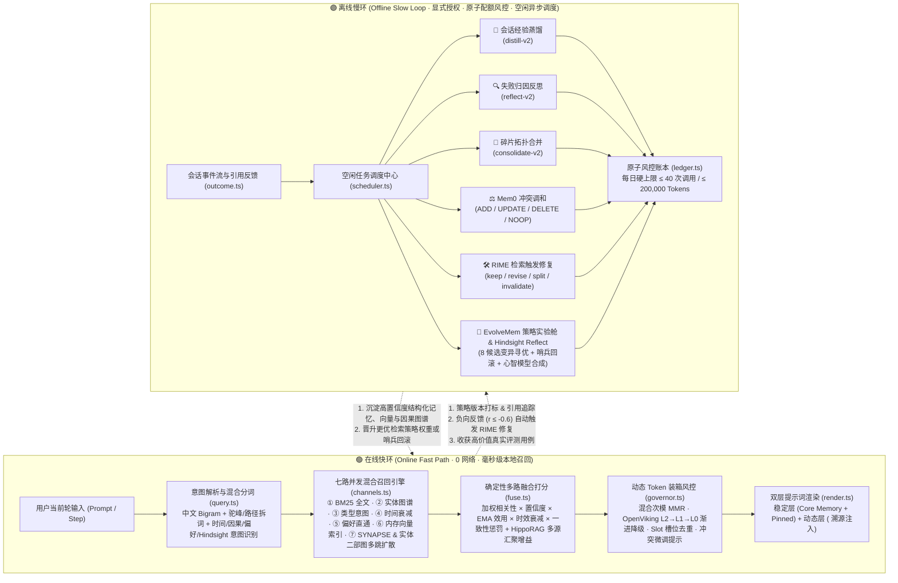

# 🧠 DSH Self-Evolving Memory System (`dsh-memory`)

<p align="center">
  
  
  
  
  <a href="https://github.com/ROSESSSSS66/dsh-memory/actions/workflows/ci.yml"></a>
  
  
  
</p>

<p align="center">
  <b>让 DeepSeek Desktop (DSH) 记住你的项目、偏好与踩过的坑</b><br>
  纯本地 · 全量向量矩阵毫秒级召回 · 4 个精简模型工具 · 零运行时依赖 · 极简自治控制台
</p>

> **一句话介绍**：`dsh-memory` 是专为 DSH 打造的零依赖纯本地长期记忆插件。它在后台自动从会话中提炼偏好、项目约定与经验教训，在每轮提问前通过 **SQLite FTS5 + 全量内存向量矩阵 + 实体图谱** 毫秒级精准注入最相关的几条记忆（万级规模 p95 仅 ~7 ms，5 万级 p95 < 28 ms）；事实演进自动取代旧结论，负向反馈触发自我修复，全程无需手动整理。
>
> | 🔒 纯本地 & 零依赖 | ⚡ 极速全量召回 | 🎯 省 Token | 🧬 闭环自进化 |
> |---|---|---|---|
> | 在线零网络、0 运行时依赖；密钥落库前脱敏，外发需显式授权 | Eval v2 p95 1.9 ms；10k 全量向量 p95 **7.0 ms**；50k p95 **27.95 ms** | 4 个精简模型工具 + MMR & L2→L1→L0 装箱，单轮均值 **82 tokens** | 后台空闲蒸馏、Mem0 调和、Hindsight 反思、RIME 修复与策略进化 |
>
> **三步上手**：在 DSH 插件市场一键安装（或运行 `dsh plugin --profile web add "https://github.com/ROSESSSSS66/dsh-memory/releases/latest/download/dsh-memory.tgz"`）→ 自动挂载并开启运行期初始化 → 打开 DSH 左侧边栏 **长期记忆** 面板即可使用。详见 [快速上手](#-快速上手与挂载)。

<p align="center">
  <a href="#-为什么选择-dsh-memory">核心优势</a> •
  <a href="#-主流记忆方案横向对比">范式对比</a> •
  <a href="#-快慢双环架构设计-architecture">双环架构</a> •
  <a href="#-claude-studio-极简自治控制台">自治控制台</a> •
  <a href="#-快速上手与挂载">快速上手</a> •
  <a href="#-交互指南与工具矩阵">交互指南</a> •
  <a href="#-权威评测与性能基准">评测基准</a>
</p>

<table align="center" width="100%">
  <tr>
    <td align="center" width="26%">
      <a href="https://www.dorodoro.xyz" target="_blank" rel="noopener noreferrer">
        <br>
        <b>DoroDoro AI</b>
      </a>
    </td>
    <td>
      <b>开发者专属高性能大模型聚合中转服务</b><br>
      • <b>全品类模型矩阵</b>：聚合全球主流商业与开源旗舰大模型，海量算力一站直达；<br>
      • <b>稳定可靠接入</b>：支持高并发调度，保障各类工具流畅调用；<br>
      • <b>零门槛接入</b>：标准 OpenAI 协议平替，完美适配各类 AI 编程工具与智能体离线演化。<br>
      👉 <a href="https://www.dorodoro.xyz" target="_blank" rel="noopener noreferrer"><b>[🔗 立即直达官网体验 ↗]</b></a>
    </td>
  </tr>
</table>

---

## 📌 为什么选择 `dsh-memory`？

在桌面级 AI 编程与智能体（Agent）日常高频协作中，传统长期记忆方案往往深陷**“三难困境”**：

1. **上下文无限膨胀与注意力稀释**：粗暴追加历史记录或全量读取 Markdown 文档会导致单轮 Token 消耗指数级攀升，关键约束被海量过时信息淹没。
2. **在线首字延迟（TTFT）劣化**：若在每轮对话前（`pre-step`）实时发起远程 Embedding 请求、向量检索或 LLM 重排，每次提问都将产生数百毫秒至数秒的网络卡顿，一旦断网甚至阻断主对话。
3. **事实过期与新旧冲突污染**：当项目架构演进（例如从 `npm` 迁移至 `pnpm`、端口从 `3000` 改为 `8080`）时，仅凭余弦相似度的静态向量库会同时召回新旧两条矛盾事实，误导模型生成错误代码。

### 💡 `dsh-memory` 的破局之道

- ⚡ **纯本地全量毫秒级多路检索**：坚持 **0 在线网络请求、0 运行时依赖、0 原生 C++ 编译负担**。基于 Node.js 24 原生 `node:sqlite` FTS5 与按工作区懒加载的全量 `Float32Array` 内存向量矩阵（`vector-index.ts`，彻底消除 Top-400 截断盲区，并支持可选接入 `openai-compatible` 远程 Embedding，未配置/离线无缝回退本地向量），配合关联图谱多跳扩散，Eval v2 标准夹具 p95 约 `1.9 ms`，10,000 条记忆压测 p95 仅 **`7.04 ms`**，50,000 条记忆 + 15 万边压测 p95 仅 **`27.95 ms`**（远优于 `50 ms` 门禁）。
- 🌱 **开箱即用与核心记忆演进**：首次加载或运行 `/memory init` 时自动初始化常驻核心记忆（`human` / `persona` / `project`）；日常协作中高频验证的事实与偏好自动沉淀至常驻层，无需人工整理。
- 🎯 **动态 Token 预算控制**：采用词法-语义混合次模 MMR 背包算法动态装箱，并支持 OpenViking `L2 → L1 → L0` 渐进式降级；记忆库从 1,000 条扩容至 10,000 条时单轮注入仅波动 `0.28%`，彻底杜绝上下文爆炸与窗口挤占。
- 🧬 **零干预闭环自愈**：后台空闲自动执行经验蒸馏、冲突调和、Hindsight 认知反思与失效记忆淘汰，支持 RIME 检索自愈与 EvolveMem 策略寻优，越用越懂你的工程习惯。

### 📚 核心算法学术论文底座 (2025–2026 前沿研究落地)

| 论文 / 范式来源 | 核心机制 | 在 `dsh-memory` 中的工程落地 |
|---|---|---|
| **HippoRAG 2** (*From RAG to Memory: Non-Parametric Continual Learning*, ICML 2025, arXiv:2502.14802) | **多源汇聚 PPR 激活累加 & 多跳阻尼传播** | `expandGraphNeighbors` 与 `fuseCandidates` 支持 1~2 跳阻尼传播（$\gamma = 0.45$），当多个硬门槛种子节点汇聚激活同一关联邻居时，累加 RRF 能量并授予多源协同增益（`convergentSeeds`） |
| **SYNAPSE** (*Empowering LLM Agents with Episodic-Semantic Memory via Spreading Activation*, Jan 2026, arXiv:2601.02744) | **ACT-R 扇出注意力稀释 (Fan Effect)** 与间隔重复 | 实现 `computeFanAttenuation(degree)`：高连接度 Hub 种子节点度数越高，单条边激活权重按 $1 / (1 + 0.25 \ln d)$ 自动衰减；结合 `computeActRBaseActivation` 频次强化半衰期 |
| **LightMem** (*Submodular Context Packing & Memory Compression*, 2025) | **词法-语义混合次模 MMR 背包 (`Hybrid MMR-VPT`)** | `governor.ts` 实现 `computeHybridOverlap` + `computeMmrMarginalScore`：同时融合词法 Jaccard 与 128D 向量余弦相似度（同类型余弦 $\ge 0.58$ 即识别语义复述），最大化有限 Token 预算下的正交信息熵 |
| **A-Mem** (*Agentic Memory for LLM Agents*, NeurIPS 2025, arXiv:2502.12110) | **Zettelkasten 卡片盒动态双链织网** | 写入新记忆（`core/writer/weave.ts`）与健康自愈（`core/health/zettelkasten.ts`）时，基于 `0.45 * 128D余弦 + 0.35 * 词法Jaccard + 0.20 * 实体共现` 自动为孤立记忆建立 Top-3 双向 `related` 关联边 |
| **Zep / Graphiti & Mem0** (arXiv:2501.13956, 2025) | **蒸馏-调和全闭环与规范槽位推演** | `extractor.ts` 与 `reconciler.ts` 深度打通：慢环蒸馏产物自动归一化工作区哈希并结合规范槽位与混合相似度决断 `ADD / UPDATE / DELETE / NOOP`，自动编织新旧技术栈演进因果边 |
| **Letta / MemGPT + MemRL / EvolveMem** (2025–2026) | **常驻核心记忆自主同步与帕累托策略进化** | `core/health/core-sync.ts` 将经实战检验的高置信偏好/规范幂等同步至 `human` / `project` 核心块；`lab.ts` 基于真实收获样本（`eval_cases`）执行策略变异寻优与哨兵自动回滚 |
| **Hindsight** (`vectorize-io/hindsight`, 2026) | **四层认知网络 (`World`/`Experience`/`Observation`/`Opinion`)、实体二部图桥接遍历与 `Reflect` 心智模型归纳** | `hindsight.ts` + `channels.ts` + `fuse.ts`：划分四层认知记忆网络并与查询意图对齐；在 `expandGraphNeighbors` 中引入 `seed -> @entity -> neighbor` 低扇出实体二部图桥接遍历；`runHindsightReflect` 基于多会话证据密度与认知倾向 (`Disposition`) 动态校准置信度并自动合成心智模型 (`hindsight.model.*`) |
| **OpenViking** (`volcengine/OpenViking`, 2026) | **`viking://` 虚拟上下文文件系统与 L0 / L1 / L2 三层渐进式上下文装箱加载** | `viking.ts` + `governor.ts` + `render.ts`：将记忆确定性映射至 `viking://{agent,user,workspace}/...` 语义目录树；在 `governor.ts` 中实现 **L2 (`content`) → L1 (`overview`) → L0 (`summary`)** 三级渐进式 Token 预算降级装箱；支持目录递归检索 (`tree` / `ls`) 与 `.abstract.md` / `.overview.md` 三层目录树无损导入导出 |

### 🆕 v0.11.0 全量架构重构、安全加固与性能跃迁
- **全量工作区内存向量矩阵 + 远程 Embedding 客户端**：
  - 新增 `src/core/vector-index.ts`：按工作区/会话分区懒加载连续 `Float32Array` 内存矩阵，采用 8x 展开点积与 `PRAGMA data_version + total_changes()` 零表读新鲜度校验，**彻底消除历史 Top-400 SQL 截断盲区**（10k 向量扫描仅 `0.51 ms`，50k 仅 `2.34 ms`）；
  - 新增 `src/core/embedding-client.ts`：正式接通 `cfg.embedding` OpenAI-compatible `/embeddings` 接口（带 SSRF 防护、显式授权校验与 8 MB 响应上限），未配置或离线时零感知回退本地 128D 向量。
- **4 个精简 Zod 校验模型工具 & 极简 Studio UI 升级**：
  - 模型侧工具面从 8 个重叠工具（38 参数）收敛为 **4 个精简原子工具**（`memory_search`、`memory_expand`、`memory_feedback`、`memory_note`），大幅降低工具 Schema Token 占用并锁紧模型信任边界；
  - Studio 侧栏控制台在保持极简全自动零运维风格的同时，新增可折叠只读 **Hindsight 四网络 & OpenViking 目录树洞察**（`EpistemicInsights.tsx`）、完整中英双语 `i18n.ts`、`MemoryErrorBoundary`、原生语义按钮/焦点陷阱与 WCAG AA 无障碍合规；
  - 后端 Web API 拆分为模块化 `src/dsh/web/*`，全部 `GET` 严格只读，新增带 `ETag`/`304` 协商缓存的聚合端点 `GET /studio-snapshot`，高风险运维写端点默认收敛于 `webAdminEnabled: false`。
- **Schema v3、3.4x–3.8x 检索加速与 P0–P3 全域安全加固**：
  - 数据库演进至 **Schema v3**（`003_integrity_and_indexes.sql` 补齐 6 个复合/部分索引与 `tr_mem_ad` FTS5 删除同步触发器）；核心写入、健康治理、应用服务与 Web 路由全面模块化（`src/core/writer/`、`src/core/health/`、`src/service/`、`src/dsh/web/`）；
  - 优化 `generateShortCodes`（纯 `UNIQUE(id)` B-tree 范围探针 + LCP 跳步）、`recallTyped`（复用 `lexical` 结果零重复 FTS5 扫描）与 BMP 零正则码位分词，10k 记忆 p95 降至 **`7.04 ms`**，50k + 15 万边 p95 降至 **`27.95 ms`**；
  - 覆盖 SSRF / 2-step API Key 窃取 / 污点洗白 / `<workspace>` 注入 / 路径穿越与符号链接 / Zstd 累积炸弹 / 跨工作区与跨会话隔离等全链路安全修复，测试扩充至 **75 文件 / 786 用例**，Eval v2 升级至 **152 条零重复基准用例**；
  - 发布产物开启生产压缩（`dist/index.js` 瘦身 43% 至 `771.8 KB`）、**0 运行时依赖**、补齐市场截图并由 `npm run pack:check` 与三平台 CI 门禁守卫。

### 🛡️ 安全边界与工程加固

| 方向 | 要点 |
|---|---|
| **数据归属与完整性 (Schema v3)** | 持久化 `session_workspace_owners` 确保离线入口按真实归属校验；私有记录在 `LIMIT` 前即排除；Schema v3 新增高规模复合索引与 `tr_mem_ad` FTS5 删除触发器，彻底杜绝幽灵索引 |
| **精简工具面与模型信任边界** | 模型侧仅暴露 4 个精简工具（`memory_search` / `memory_expand` / `memory_feedback` / `memory_note`）；模型自身置信度或确认次数不能批准候选；`core:*` 槽位不可被模型占用；无证据 `discard` 不得归档用户确认过的记忆 |
| **Web 运维写端点默认关闭** | 新增 `webAdminEnabled` 配置开关（默认 `false`），默认关闭高风险 Web 运维写端点，常规治理建议走 `/memory` 斜杠指令；仅在显式开启后放行 |
| **显式离线授权与外发防护** | 必须显式设置 `privacy.offlineConsent: true` 才会向外部 LLM / Embedding 发起离线请求；整条 Cookie / Set-Cookie 头脱敏；禁止自动跟随 HTTP 重定向；校验 Base URL 与密钥环境变量名白名单 |
| **备份与原子恢复** | 备份、导出、导入前快照统一使用 `VACUUM INTO` + 只读校验 + 原子发布，快照失败即中止导入 |

---

## 📊 主流记忆方案横向对比

`dsh-memory` 并非单一的向量检索插件，而是将业界前沿 Agent 记忆范式深度融合于纯本地双环引擎之中：

| 对比维度 | 传统向量 RAG 插件 | 纯文档记忆 (Cline Memory Bank) | 云端托管记忆 (Mem0 / Zep) | **🧠 `dsh-memory` (v0.11.0)** |
|---|---|---|---|---|
| **安装后冷启动** | ❌ 空白库，需手动逐条喂入 | ❌ 需手动编写多份 Markdown | ❌ 空白库，需业务侧自行灌库 | **✅ 零运行时依赖，免 `allowBuilds`，首次启动自动扫描工程并初始化记忆** |
| **在线检索延迟** | `100 ~ 600ms` (依赖远程 Embedding) | `< 5ms` (全量读取本地文件) | `150 ~ 800ms` (网络往返 API) | **Eval 夹具 `1.9 ms` p95 · 10k 全量 `7.0 ms` p95 · 50k `27.95 ms` p95（纯本地）** |
| **Token 成本控制** | 固定 Top-K，易超预算 | 随文档增长线性膨胀，极易爆窗 | 依赖服务端截断策略 | **混合次模 MMR + `L2→L1→L0` 降级装箱，1k→10k 仅波动 `0.28%`** |
| **常驻工作台记忆** | ❌ 不支持 | ✅ 手动维护 Markdown | ⚠️ 需额外定制 | **✅ 内置 Letta 风格三大核心块 (`human`/`persona`/`project`)** |
| **新旧事实冲突消解** | ❌ 新旧并存，互相污染 | ⚠️ 依赖模型自觉覆盖全文 | ✅ 在线同步调用 LLM 调和 | **✅ 槽位唯一索引 + Mem0 冲突调和器 + `supersedes` 因果链** |
| **认知建模与分层目录** | ❌ 扁平文本块 | ⚠️ 手工维护目录结构 | ⚠️ 有限标签分类 | **✅ Hindsight 四层认知网络 + OpenViking `viking://` 虚拟上下文文件系统** |
| **负反馈自愈与策略进化** | ❌ 静态死参数，永不进化 | ❌ 无 | ❌ 黑盒策略，不可调优 | **✅ RIME 负反馈自动修复 + EvolveMem 进化实验舱 + 哨兵回滚** |
| **记忆库健康度治理** | ❌ 无 | ❌ 无 | ⚠️ 仅基础统计 | **✅ 内置 Memory Doctor (0-100 评分、128D 语义冗余检测、一键智能自愈 `autoHeal`)** |
| **隐私安全与离线可用** | ⚠️ 文本需外发至 Embedding 端 | ✅ 纯本地文件 | ❌ 核心数据上传第三方云端 | **✅ 在线 100% 离线可用 + 显式 `offlineConsent` 闸门 + 凭据落库前脱敏** |

---

## 🏗️ 快慢双环架构设计 (Architecture)

系统采用 **“在线快环（Online Fast Path）+ 离线慢环（Offline Slow Loop）”** 彻底解耦设计，两条环路通过 SQLite WAL 事务与遥测账本构成完整自进化闭环：



---

## 🎨 Claude Studio 极简自治控制台

`dsh-memory` 内置对齐 **`Nwflower/dsh-claude-style`** 视觉体系的 **Claude Desktop Studio 极简自治侧栏控制台**，直连 `--dsw-alias-*` 与 `--dsh-claude-*` 原生设计令牌，奉行 **“系统全自治运行、界面零手工按钮负担”** 的设计哲学：

### 1. 🔘 全局唯一交互按钮：模型配置热保存浮层 (`LLMConfigModal`)
- 整个侧栏控制台严格仅保留右上角唯一的 **「模型配置」** 按钮。
- 支持选择 **`DSH 宿主内置模型`**（复用宿主环境凭据）或主流 OpenAI / Anthropic 兼容中转服务；支持显式开关离线授权、防抖自动热落盘与连通性检测。

### 2. 📊 3×2 全自治遥测仪表盘 (`Autonomous Telemetry Grid`)
- 实时呈现 **活跃记忆水位**、**Memory Doctor 健康分与等级（`A+` ~ `D`）**、**活跃检索策略版本（EvolveMem）**、**常驻稳定层真实 Token 预算占用（`stableLayerTokens / stableBudgetTokens`）**、**向量覆盖率** 与 **今日慢环 LLM 配额水位**。
- 每轮对话结束（`turn-stopping`）与后台心跳周期自动编排 `autoHeal`、`distill`、`consolidate`、`maintain` 与 `evolve`，用户无需点击任何手动运维开关。

### 3. 🧠 Hindsight & OpenViking 认知洞察透视 (`EpistemicInsights`)
- 直观呈现四层认知记忆网络（`World` / `Experience` / `Observation` / `Opinion`）分布、心智模型演化状态与 `viking://` 语义目录树层级概览。

### 4. 🧬 常驻核心记忆与折叠记忆流 (`Core Memory` & `Live Memory Stream`)
- 展示 **`human`**、**`persona`**、**`project`** 三大常驻核心块及其字符水位，随 `syncAutonomousCoreMemory` 自动演进更新。
- 内置零按钮原生 `<input type="search">` 即时过滤框与 Claude Code 风格 `<details>` 折叠流，并由 `MemoryErrorBoundary` 提供故障隔离与双语 `i18n` 支持。

---

## ✨ 核心技术亮点一览

| 维度 | 核心能力 | 技术实现与工程指标 |
|---|---|---|
| **存储与依赖** | **零运行时依赖 · Schema v3** | 基于 Node.js 24 原生 `node:sqlite` + FTS5 全文索引，`tsup` 内联打包，彻底告别 `node-gyp` 编译报错与跨平台依赖冲突 |
| **混合检索** | **七路并发召回 + 紧凑向量矩阵** | 中文 Bigram/3-gram + 层级路径前缀 + BM25 + 实体图谱 + 类型路由 + 时间衰减 + 偏好直通 + **`vector-index.ts` 内存向量矩阵** + **SYNAPSE / HippoRAG 2 / Hindsight 实体二部图多跳扩散** |
| **预算治理** | **混合次模 MMR + 三层渐进降级** | `governor.ts` 融合词法-语义次模装箱与 OpenViking `L2 → L1 → L0` 降级，硬性锁定稳定层（600t）与动态层（1600t）上限，1k→10k 规模注入波动 `< 0.3%` |
| **冲突自愈** | **蒸馏-Mem0-RIME 全闭环** | 慢环蒸馏产物自动经 Mem0 混合调和消解冲突并挂接因果边；检索侧遇负反馈自动触发 RIME 异步修复并在自愈周期自动应用 |
| **策略进化** | **EvolveMem + 哨兵回滚** | 离线在 152 条 Eval v2 基准用例与真实收获用例（`eval_cases`）上变异寻优；上线后若用户纠偏率劣化超过父版本 `+5%`，哨兵机制自动无损回滚 |
| **隐私安全** | **敏感凭据零落盘 + 显式外发授权** | 内置多层正则隐私守卫（`privacy.ts`）拦截密钥、Token、Cookie 与私钥；离线外发严格受 `privacy.offlineConsent` 与 `allowedOfflineEndpoints` 门控；高风险 Web 运维端点由 `webAdminEnabled` 默认关闭 |
| **成本风控** | **原子级配额账本** | `ledger.ts` 采用先预留后扣减的事务机制，严格执行每日 **≤ 40 次调用 / ≤ 200,000 Tokens** 硬上限，杜绝后台死循环账单 |

---

## 📁 代码目录全景

```text
dsh-memory/
├─ package.json                # 插件包元数据、零运行时依赖清单、导出入口与脚本 (v0.11.0)
├─ tsconfig.json               # 严格 ESM TypeScript 编译配置
├─ tsup.config.ts              # 服务端单文件 ESM 打包与评测 CLI 构建配置
├─ vitest.config.ts            # Vitest 测试与 V8 覆盖率配置
├─ biome.json                  # Biome 静态检查与格式化配置
├─ CONTRIBUTING.md             # 分支保护规范与 PR 贡献指南
├─ docs/archive/               # 归档的历史规划与里程碑记录 (PLAN / NOTES / PROGRESS / APPENDIX-A/B)
├─ scripts/
│  ├─ build-client.mjs         # 前端侧栏 CJS/ModuleLoader 安全封装构建脚本
│  ├─ postinstall.mjs          # 冷启动初始化脚本 (支持 --force / --dry-run / --no-backfill 与 Schema v3 兜底)
│  ├─ run-eval.mjs             # 跨平台评测门禁启动包装脚本
│  └─ verify-pack.mjs          # 发布包完整性校验 (screenshots / exports / 0 .map / 0 runtime deps)
├─ src/
│  ├─ index.ts                 # 插件标准导出入口
│  ├─ config.ts                # 全局配置中心、默认值 (含 webAdminEnabled / embedding / offlineLLM) 与校验
│  ├─ types.ts                 # 核心领域模型 (MemoryRecord, Strategy, GraphData 等)
│  ├─ service/                 # 应用服务层 (解耦 DSH Web/CLI 与底层核心引擎)
│  │  ├─ index.ts              # 服务层统一导出
│  │  ├─ memory-service.ts     # 记忆查询、统计、CRUD 与核心块编排服务
│  │  ├─ maintenance-service.ts # 体检、自愈、导出/导入与备份编排服务
│  │  ├─ llm-probe.ts          # 离线 LLM / Embedding 端点连通性与安全探测
│  │  └─ scope-guard.ts        # 工作区排除与作用域访问守卫
│  ├─ core/                    # 底层独立存储与计算核心 (零宿主耦合)
│  │  ├─ db.ts                 # SQLite 封装 (node:sqlite 原生驱动 + WAL + FTS5 + Schema v3 迁移)
│  │  ├─ migrations/           # 版本化 SQL 迁移 (001_init / 002_session_owners / 003_integrity_and_indexes)
│  │  ├─ text.ts               # 混合分词器 (中文 Bigram + 词干还原 + 代码标识符拆解)
│  │  ├─ tokens.ts             # 离线 Token 估算器与安全边界截断
│  │  ├─ scope.ts              # Session / Workspace / User / Global 四级作用域哈希隔离
│  │  ├─ privacy.ts            # 敏感密钥、Cookie、Token 与凭据实时脱敏拦截器
│  │  ├─ writer.ts             # 单一事务写入总入口 (门面)
│  │  ├─ writer/               # 写入子模块 (validate / slot-policy / persistence / weave / lifecycle)
│  │  ├─ store.ts              # 只读查询、多维统计、全局图谱、K-Hop 局部子图与 Mermaid 渲染
│  │  ├─ core-memory.ts        # Letta/MemGPT 风格常驻核心记忆块 (human/persona/project)
│  │  ├─ bootstrap.ts          # 首次加载与手动初始化的工作区冷启动引擎
│  │  ├─ markdown.ts           # Markdown / Memory Bank / Viking 目录树双向同步与 .trash 回收站
│  │  ├─ vector.ts             # 128 维确定性语义特征向量与特征提取
│  │  ├─ vector-index.ts       # 紧凑型内存向量矩阵索引与事务后增量同步
│  │  ├─ embedding-client.ts   # 可选离线 openai-compatible Embedding 客户端 (异常自动回退本地向量)
│  │  ├─ hindsight.ts          # Hindsight 四层认知网络、证据密度演化与心智模型 Reflect 合成
│  │  ├─ viking.ts             # OpenViking `viking://` 虚拟上下文文件系统与 L0/L1/L2 分层视图
│  │  ├─ trust.ts              # 用户证据信任边界判定
│  │  ├─ health.ts             # 记忆库健康治理总入口 (门面)
│  │  └─ health/               # 健康治理子模块 (audit / auto-heal / core-sync / zettelkasten)
│  ├─ ingest/                  # 增量事件摄入与历史回填 (rules / queue / backfill)
│  ├─ retrieval/               # 在线毫秒级多路召回与融合 (query / channels / fuse / governor / render / recall)
│  ├─ dsh/                     # DSH 宿主深度集成适配层
│  │  ├─ plugin.ts             # 插件生命周期、预同步编排与慢环接线入口
│  │  ├─ job-handlers.ts       # 离线慢环任务处理器注册与编排
│  │  ├─ scope-resolver.ts     # 运行时会话与工作区上下文解析器
│  │  ├─ session-listener.ts   # 会话状态流转与消息事件监听
│  │  ├─ prompt-section.ts     # 稳定层 System Prompt 常驻注入
│  │  ├─ memory-visibility.ts  # 已注入记忆可见性投影、去重与压缩/fork 后重折叠
│  │  ├─ pre-step.ts           # agent/pre-step 动态记忆注入与在线遥测落盘
│  │  ├─ tool-registry.ts      # 4 个精简模型工具注册表 (memory_search/expand/feedback/note)
│  │  ├─ tools.ts              # 工具核心实现
│  │  ├─ commands.ts           # `/memory` 聊天交互指令集 (20+ 运维与治理子命令)
│  │  ├─ web.ts                # Studio 侧栏 Web API 入口
│  │  └─ web/                  # Web 路由、安全鉴权与分域路由处理器 (http / router / security / routes/)
│  ├─ client/                  # Claude Studio 极简自治控制台 (React 19)
│  │  ├─ index.ts              # DSH 侧栏挂载入口与内联图标
│  │  ├─ MemoryApp.tsx         # 3×2 自治遥测、Core Memory、认知洞察与折叠记忆流
│  │  ├─ i18n.ts               # 中英双语文案字典与本地化钩子
│  │  ├─ styles.ts & types.ts  # Studio 设计令牌样式表与前后端通信类型契约
│  │  └─ components/           # MemoryHeader / LLMConfigModal / EpistemicInsights / MemoryErrorBoundary
│  ├─ evolution/               # 离线自进化慢环 (ledger / llm / prompts / parse / extractor / reflector / consolidator / reconciler / lab / outcome / repair / maintenance / strategy / review-snapshot)
│  ├─ jobs/                    # 离线任务并发调度与互斥执行器 (scheduler / runner / types)
│  └─ eval/                    # 自动化基准评测体系 (gen-dataset / runner / metrics / eval-cli)
└─ test/                       # 单元、集成、边界安全与端到端验收测试套件
```

---

## 🚀 快速上手与挂载

### 1. 安装与构建

**方式 A：通过 DSH 插件市场 / Release 构建包一键安装（无需本地构建）**

```bash
dsh plugin --profile web add "https://github.com/ROSESSSSS66/dsh-memory/releases/latest/download/dsh-memory.tgz"
# 或指定版本包 / npm 直接安装：
# npm i https://github.com/ROSESSSSS66/dsh-memory/releases/download/v0.11.0/dsh-memory-0.11.0.tgz
```

**方式 B：克隆源码并构建**

> **环境要求**：Node.js `>= 24.0.0`（利用内置 `node:sqlite` 原生模块，无需安装 Python 或 Visual Studio C++ 构建工具）。

```bash
git clone https://github.com/ROSESSSSS66/dsh-memory.git
cd dsh-memory
npm install
npm run build
```

构建完成后将生成三大产物（发布包仅包含运行必需的 `dist/index.js`、`dist/index.d.ts`、`dist/client.js`，自动剥离 sourcemap 与开发期 CLI）：
- `dist/index.js`：DSH 服务端插件单文件 ESM 主入口
- `dist/client.js`：DSH 侧栏 Claude Studio 极简自治控制台前端包
- `dist/eval-cli.js`：Eval v2（152 用例）基准评测命令行工具（仅本地开发 / CI 使用）

### 2. 挂载至 DeepSeek Desktop (DSH)

打开 DSH Desktop 配置补丁文件（通常位于 `~/.dsh/profiles/desktop/cordis.patch.yml`），追加插件配置：

```yaml
- insert:
    - id: dsh-memory
      name: dsh-memory
      config:
        enabled: true
        # 动态情境装箱预算（默认 1600 tokens）
        dynamicBudgetTokens: 1600
        # 稳定层 System Prompt 预算（默认 600 tokens）
        stableBudgetTokens: 600
        # 离线演进 LLM 每日调用与 Token 硬配额
        dailyLLMCalls: 40
        dailyLLMTokens: 200000
        # 高风险 Web 运维写端点开关（默认 false，建议保持关闭并使用 /memory CLI）
        webAdminEnabled: false
```

在 `~/.dsh/profiles/desktop/package.json` 中添加本地模块软链：

```json
{
  "dependencies": {
    "dsh-memory": "link:/path/to/dsh-memory"
  }
}
```

保存后 DSH 将通过 HMR 热重载自动激活插件，并在侧边栏出现 **🧠 长期记忆** 图标。SQLite 实体库默认初始化于：
`~/.dsh/storages/dsh-memory/memory.db`

### 3. 配置离线自进化 LLM、显式外发授权与可选 Embedding

`dsh-memory` 后台离线慢环（会话提炼 `distill-v2`、失败反思 `reflect-v2`、知识聚合 `consolidate-v2`）默认严格遵循**最小外发原则**：必须显式配置 `offlineLLM` 并开启 `privacy.offlineConsent: true` 才会向远程端点发起请求。推荐搭配 **[DoroDoro AI 中转站 (www.dorodoro.xyz)](https://www.dorodoro.xyz)** 或自定义 OpenAI / Anthropic 兼容端点：

```yaml
      config:
        # 1. 离线自演化 LLM 规范配置（推荐通过 apiKeyEnv 读取环境变量，避免明文落盘）
        offlineLLM:
          useDshLlm: false
          baseURL: "https://api.dorodoro.xyz/v1"
          model: "deepseek-ai/deepseek-v4-flash-0731"
          apiKeyEnv: "DORODORO_API_KEY"
          protocol: "chat/completions" # 可选: chat/completions | responses | messages

        # 2. 显式隐私与外发白名单授权（必须显式为 true 才允许离线外发）
        privacy:
          offlineConsent: true
          allowedOfflineEndpoints:
            - "https://api.dorodoro.xyz/v1"

        # 3. 可选：远程语义 Embedding（默认 provider: 'none' 使用纯本地 128D 向量；开启后仅在离线阶段计算，离线/失败无缝回退本地）
        embedding:
          provider: "openai-compatible" # 默认 "none"
          baseURL: "https://api.dorodoro.xyz/v1"
          model: "text-embedding-3-small"
          apiKeyEnv: "DORODORO_API_KEY"
          dim: 1536
          batchSize: 32
          timeoutMs: 15000

        # 4. 可选：显式放行 Web 运维写端点（默认 false；生产环境建议保持 false，改用 /memory 斜杠指令）
        webAdminEnabled: false
```

> **关于 `webAdminEnabled` 安全门控**：当 `webAdminEnabled` 为 `false`（默认值）时，侧栏控制台可正常读取遥测、记忆流、认知洞察并保存模型配置，但所有高风险/破坏性 Web 运维写端点（如批量删除、直接覆写、强制导入/导出、手动触发维护等）均被拒绝（返回 `403`），请使用 DSH 聊天窗口中的 `/memory` 斜杠命令完成人工治理；仅在本地受信调试场景确有需要时将其显式设为 `true`。

---

## 🎮 交互指南与工具矩阵

### 1. 聊天窗口斜杠指令 (`/memory`)

| 类别 | 交互命令 | 功能说明 |
|---|---|---|
| **状态与初始化** | `/memory init [--force]` | 一键执行工作区记忆冷启动初始化（扫描项目架构、初始化 Letta 核心块、导入文档、回填会话、补齐向量并编织 A-Mem 图谱） |
| | `/memory status` (或 `stats`) | 实时查看当前工作区记忆分布、活跃检索策略版本及今日 LLM 配额消耗 |
| | `/memory doctor [--fix]` | 执行记忆库全面体检（0-100 评分、FTS5 同步校验、向量覆盖率、A-Mem 孤立节点诊断、语义冗余对与冲突诊断；加 `--fix` 自动自愈） |
| | `/memory heal` | 一键智能自愈：自动修复 FTS5 索引、回填向量、编织 A-Mem 双链、合并同槽位冗余并消解非冻结矛盾 |
| | `/memory eval` | 原地运行 Eval v2（152 用例）基准回归评测，即时输出召回率、MRR/NDCG、隔离度与延迟报告 |
| **前沿范式** | `/memory core [block] [内容]` | **`[Letta]`** 查看或更新常驻 Core Memory 核心块（`human` / `persona` / `project`） |
| | `/memory tree [viking://uri] [--l1\|--l2]` | **`[OpenViking]`** 在 `viking://` 虚拟上下文文件系统上执行目录递归检索与 L0 (`.abstract`) / L1 (`.overview`) / L2 (`detail`) 分层浏览 |
| | `/memory reflect [topic]` | **`[Hindsight]`** 执行四层认知网络 (`World`/`Experience`/`Observation`/`Opinion`) 盘点、证据密度置信度校准与跨网络心智模型 (`Mental Model`) 自动归纳合成 |
| | `/memory export-viking [目录]` / `import-viking` | **`[OpenViking]`** 导出或导入带 L0 `.abstract.md`、L1 `.overview.md` 与 L2 `.md` 的三层虚拟上下文目录树 |
| | `/memory reconcile <内容>` | **`[Mem0]`** 对输入事实执行动态冲突调和（自动判定 `ADD/UPDATE/DELETE/NOOP`）并落库 |
| | `/memory export-bank [目录]` / `import-bank` | **`[Cline]`** 导出或双向同步标准化四文件 Memory Bank（`activeContext`、`systemPatterns` 等） |
| **浏览与治理** | `/memory list [页码]` | 分页浏览已沉淀记忆，展示短码 ID、类型、置信度与最后活跃时间 |
| | `/memory inspect <ID>` | 深度检视单条记忆正文、来源会话证据及**双向拓扑关系（`->` 出向 / `<-` 入向）** |
| | `/memory confirm <ID>` / `approve <ID>` | 显式确认或审批候选事实，提升置信度与效用并激活为 `active` |
| | `/memory merge <源ID> <目标ID>` | 合并两条冗余记忆，自动迁移关联并将源记忆标记为 `superseded` |
| | `/memory pin <ID>` / `unpin <ID>` | 将关键记忆固定至稳定层 System Prompt / 取消置顶 |
| | `/memory freeze <ID>` / `unfreeze` | 冻结记忆（禁止离线慢环修改或覆盖） / 解除冻结 |
| | `/memory forget <ID>` / `restore <ID>` | 归档废弃记忆（写入 `.trash/` 回收站存根） / 一键恢复为活跃记忆 |
| **图谱与迁移** | `/memory graph [ID或limit]` | 提取全局核心图谱或指定记忆 ID 的 **1~2 跳 Ego-Network 局部子图**，直接生成 Mermaid 拓扑图 |
| | `/memory export-md <目录>` / `import-md` | 将记忆导出为带 YAML Frontmatter 的可读 Markdown 目录 / 增量同步恢复 |
| | `/memory export <文件路径>` / `import` | 导出经 `VACUUM INTO` 校验的 SQLite 数据库快照或 JSON 备份 / 原子恢复记忆库 |

### 2. 模型自主工具 (4 Lean Model Tools)

为兼顾最小工具 Schema Token 开销与严格的安全信任边界（防止模型绕过用户审批直接修改、合并或覆盖已生效记忆），插件向智能体仅暴露 **4 个精简原子工具**：

| 工具名 | 职责说明 | 安全与预算约束 |
|---|---|---|
| **`memory_search`** | 当前上下文缺少背景知识时，主动发起全量七路混合检索（支持 `types`、Hindsight `network`、OpenViking `uriPrefix` 与 `L0`/`L1` 分层输出） | 纯本地零网络；单次返回上限 `800 tokens`，仅记录实际返回引用 |
| **`memory_expand`** | 按需展开某条记忆（支持完整 ID、4 位短码或 `viking://` 路径）的 `L0`/`L1`/`L2` 内容、来源证据及 **1-Hop 双向拓扑关联 (`Relations`)** | 严格按当前工作区/会话作用域隔离；单次上限 `1500 tokens` |
| **`memory_feedback`** | 对本会话已注入或已展开的记忆引用提交正/负向效用反馈（驱动 EMA 效用学习；负向反馈自动触发 RIME 冲突修复入队） | 校验 `contentRev` 与实际引用记录，同一引用每会话仅计一次 |
| **`memory_note`** | 记录一条高价值待审批候选备忘（`fact` / `preference` / `procedure`） | 强制写入 `status = 'candidate'`（不可自我晋升），每轮限流 ≤ 3 次 |

> **提示**：建议在 DSH 配置中保持 `tools.mode` 为 `native`（或 `both`），以确保上述 4 个精简工具对模型原生可见。所有人工审批、核心块维护、体检自愈与导入导出均通过 `/memory` 斜杠命令执行。

---

## 📈 权威评测与性能基准

项目内置完整的 Eval v2 离线评测生成器（7 大评测套件共 152 条跨领域标准用例 + 28 条关键红线用例）、多级规模压测器与发布包产物门禁：

```bash
# 1. 运行 TypeScript 严格类型检查与全量 Vitest 自动化测试套件
npm run check

# 2. 构建服务端插件、前端 Claude Studio 自治控制台与评测 CLI
npm run build

# 3. 执行 Eval v2 (152 用例) 基准评测门禁
npm run eval

# 4. 校验发布包产物完整性 (screenshots / exports / 0 .map / 0 runtime deps)
npm run pack:check
```

### 评测门禁达成实测对照表

| 验收核心指标 | 官方规约门槛 | `v0.11.0` 实测表现 | 门禁结论 |
|---|---:|---:|:---:|
| **自动化测试套件（Unit / Security / UI / Integration）** | 100% 通过 | **75 文件 / 786 用例** · 严格 TS & Biome Lint **0 errors** | ✅ **PASS** |
| **Recall @ Inject (有效注入召回率)** | $\ge 70\%$ | **99.3% (151 / 152)** · Precision **97.8%** | ✅ **PASS** |
| **MRR / NDCG (排序质量)** | — | **MRR 0.996 · NDCG 0.997** | ✅ **PASS** |
| **Exclude Violations (跨区/废弃违规注入)** | $= 0$ (绝对零容忍) | **0** | ✅ **PASS** |
| **Empty Precision (无关提问精准空查率)** | $\ge 80\%$ | **100.0%** | ✅ **PASS** |
| **Critical 关键红线用例通过率** | $100\%$ (28/28) | **28 / 28 (100%)** | ✅ **PASS** |
| **在线检索延迟 — Eval v2 标准夹具 (152 用例)** | $\le 50\text{ ms}$ | **p50 1.0 ms · p95 1.9 ms** | ✅ **PASS** |
| **在线检索延迟 — 10,000 条记忆（全量向量 0 截断）** | $\le 50\text{ ms}$ | **p50 6.23 ms · p95 7.04 ms**（+3 万边多意图 p95 **8.16 ms**） | ✅ **PASS** |
| **在线检索延迟 — 50,000 条记忆 + 150,000 边压测** | $\le 50\text{ ms}$ | **p50 14.19 ms · p95 27.95 ms**（50k 向量扫描仅 `2.34 ms`） | ✅ **PASS** |
| **单轮动态 Token 消耗均值** | $\le 1600\text{ tokens}$ | **82 tokens** (Eval v2 均值 · 最大 471 tokens) | ✅ **PASS** |
| **1k vs 10k 规模 Token 膨胀率** | $< 10\%$ 波动 | **0.28%** (规模不变性达成) | ✅ **PASS** |

---

## 🛡️ 安全、可靠性与工程鲁棒性

1. **在线路径零外部阻断**：在线检索与渲染路径 100% 运行于本地内存与 SQLite WAL 之上。即便外部网络完全断开或第三方大模型服务宕机，DSH 主会话依然拥有完整的毫秒级记忆召回能力。
2. **数据库锁竞争与异常优雅降级**：若底层数据库因极端情况被外部进程锁定或损坏，插件启动与执行期均具备异常捕获与安全旁路降级机制，绝不阻塞或崩溃 DSH 宿主进程。
3. **配额与重试可控**：失败任务按 `next_eligible_at` 退避重试并自动唤醒，次日预算自动恢复，显式 `0` 预算在稳定层、动态层与评测中均被尊重。
4. **单向因果链与完整时间线可解释性**：所有事实修订（`supersedes`）、提炼派生（`derived_from`）与冲突标记（`contradicts`）均保留历史版本快照与会话证据切片，任何一条注入提示词的记忆皆可一追到底。

---

## 🤝 贡献与分支规范

本项目实行严格的分支保护与跨平台（Linux / Windows / macOS）自动化 CI 门禁机制，所有代码提交均须遵循：
- **禁止直接推送（Push）至 `main` 主分支**；
- 必须基于 `feat/*`、`fix/*`、`docs/*` 等特性分支开发，并在本地通过 `npm run check && npm run build && npm run eval && npm run pack:check`；
- 提交 Pull Request，待 GitHub Actions 三平台自动化门禁全绿与代码审查通过后合并。

详细流程请查阅：[CONTRIBUTING.md](CONTRIBUTING.md)。历史设计蓝图与里程碑台账已归档于 [`docs/archive/`](docs/archive/)。

---

## 📄 开源许可证

本项目基于 [MIT License](LICENSE) 开源。欢迎提交 Issue 与 Pull Request 共建下一代智能体自进化记忆基础设施！
