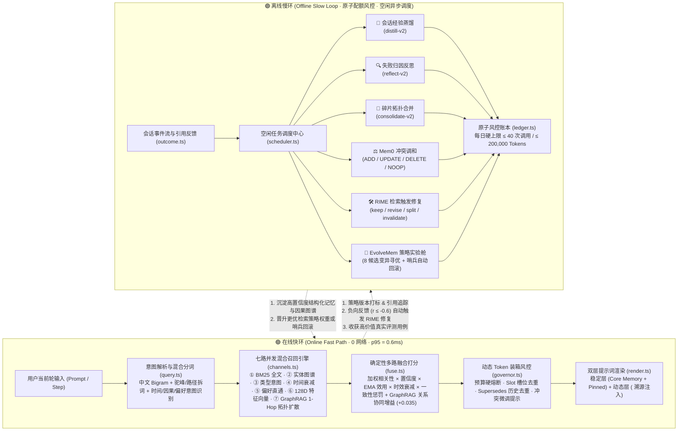

# 🧠 DSH Self-Evolving Memory System (`dsh-memory`)

<p align="center">
  
  
  
  
  
  
  
  
  
</p>

<p align="center">
  <b>专为 DeepSeek Desktop (DSH) 打造的亚毫秒级、零干预自进化、可解释长期记忆引擎</b><br>
  融合 <b>写入期同步 128D 语义向量持久化</b> · <b>HippoRAG 2 多源汇聚 PPR 激活</b> · <b>SYNAPSE 扇出衰减多跳扩散</b> · <b>LightMem 词法-语义混合次模 MMR 装箱</b> · <b>A-Mem 卡片盒双链织网</b> · <b>Letta 核心块自主晋升同步</b> · <b>蒸馏-Mem0 调和闭环</b> · <b>Claude Studio 单按钮极简控制台</b>
</p>

<p align="center">
  <a href="#-为什么选择-dsh-memory">核心优势</a> •
  <a href="#-主流记忆方案横向对比">范式对比</a> •
  <a href="#️-快慢双环架构设计">双环架构</a> •
  <a href="#-claude-studio-极简自治控制台">自治控制台</a> •
  <a href="#-快速上手与挂载">快速上手</a> •
  <a href="#-交互指南与工具矩阵">交互指南</a> •
  <a href="#-权威评测与性能基准">评测基准</a>
</p>

<table align="center" width="100%">
  <tr>
    <td align="center" width="26%">
      <a href="https://www.dorodoro.xyz" target="_blank" rel="noopener noreferrer">
        <br>
        <b>DoroDoro AI</b>
      </a>
    </td>
    <td>
      <b>开发者专属高性能大模型聚合中转服务</b><br>
      • <b>全品类模型矩阵</b>：聚合全球主流商业与开源旗舰大模型，海量算力一站直达；<br>
      • <b>稳定可靠接入</b>：支持高并发调度，保障各类工具流畅调用；<br>
      • <b>零门槛接入</b>：标准 OpenAI 协议平替，完美适配各类 AI 编程工具与智能体离线演化。<br>
      👉 <a href="https://www.dorodoro.xyz" target="_blank" rel="noopener noreferrer"><b>[🔗 立即直达官网体验 ↗]</b></a>
    </td>
  </tr>
</table>

---

## 📌 为什么选择 `dsh-memory`？

在桌面级 AI 编程与智能体（Agent）日常高频协作中，传统长期记忆方案往往深陷**“三难困境”**：

1. **上下文无限膨胀与注意力稀释**：粗暴追加历史记录或全量读取 Markdown 文档会导致单轮 Token 消耗指数级攀升，关键约束被海量过时信息淹没。
2. **在线首字延迟（TTFT）劣化**：若在每轮对话前（`pre-step`）实时发起远程 Embedding 请求、向量检索或 LLM 重排，每次提问都将产生数百毫秒至数秒的网络卡顿，一旦断网甚至阻断主对话。
3. **事实过期与新旧冲突污染**：当项目架构演进（例如从 `npm` 迁移至 `pnpm`、端口从 `3000` 改为 `8080`）时，仅凭余弦相似度的静态向量库会同时召回新旧两条矛盾事实，误导模型生成错误代码。

### 💡 `dsh-memory` 的破局之道

- ⚡ **亚毫秒级纯本地七路混合快环（p95 仅 `0.6~1.4ms`）**：在线检索链路坚持 **0 网络请求、0 外部 API 依赖、0 原生 C++ 编译负担**。基于 Node.js 24 原生 `node:sqlite` + FTS5 全文引擎、**写入期事务内同步持久化的 128 维确定性语义特征向量（融合路径层级目录前缀 `dir:`、中文 3-gram 亚词特征与 Top-400 效用优先扫描，消除 >150 条冷启动盲区）** 与 **SYNAPSE (Jan 2026) / HippoRAG 2 扇出衰减 1~2 跳激活扩散（`computeFanAttenuation` + `expandGraphNeighbors`）+ A-Mem (NeurIPS 2025) 自动卡片盒双链织网**，七路并发召回在 10,000 条记忆规模下依然保持极速响应。
- 🌱 **安装即用 · 全自动工作区记忆冷启动与核心块自主演进 (`Auto-Bootstrap & Autonomous Core Sync`) `[v0.7.0]`**：在执行 `npm install`（通过 `postinstall` 钩子）或插件首次挂载启动时，自动扫描当前工程架构并幂等初始化 **Letta 三大常驻核心块 (`human` / `persona` / `project`)**；随着日常高频协作，记忆自愈引擎（`syncAutonomousCoreMemory`）还会自动将跨轮验证过的高效用偏好与工程规范幂等晋升同步至 Core Memory，无需手动维护。
- 🎯 **词法-语义混合次模装箱（Hybrid MMR Token Governor）`[v0.7.0]`**：采用“稳定层（System Prompt 常驻偏好 + Letta Core Memory）+ 动态层（`pre-step` 词法 Jaccard + 128D 余弦混合次模 MMR 背包算法）”双层注入，精准抑制同义不同词的近似复述挤占窗口。实测记忆库从 1,000 条扩容至 10,000 条时，单轮注入 Token 均值稳定在 **~170 tokens**，体积膨胀率仅 **0.28%**。
- 🧬 **零人工干预的闭环自进化（水位线连续蒸馏 + Mem0 调和 + RIME 自愈 + EvolveMem）`[v0.7.0]`**：多轮长会话采用水位线序列键（`${sessionId}:seq:${minSeq}`）连续增量蒸馏，蒸馏产物在落盘前自动经由 **Mem0 混合冲突调和器** 执行去重与 `contradicts` / `supersedes` 因果挂接；后台自动应用已验证 RIME 修复提案、晋升高置信度候选记忆，并通过 **EvolveMem 进化实验舱** 搜寻更优检索权重。

### 📚 v0.7.0 核心算法学术论文底座 (2025–2026 前沿研究落地)

| 论文 / 范式来源 | 核心机制 | 在 `dsh-memory` v0.7.0 中的工程落地 |
|---|---|---|
| **HippoRAG 2** (*From RAG to Memory: Non-Parametric Continual Learning*, ICML 2025, arXiv:2502.14802) | **多源汇聚 PPR 激活累加 & 多跳阻尼传播** | `expandGraphNeighbors` 与 `fuseCandidates` 支持 1~2 跳阻尼传播（$\gamma = 0.45$），当多个硬门槛种子节点汇聚激活同一关联邻居时，累加 RRF 能量并授予多源协同增益（`convergentSeeds`） |
| **SYNAPSE** (*Empowering LLM Agents with Episodic-Semantic Memory via Spreading Activation*, Jan 2026, arXiv:2601.02744) | **ACT-R 扇出注意力稀释 (Fan Effect)** 与间隔重复 | 实现 `computeFanAttenuation(degree)`：高连接度 Hub 种子节点度数越高，单条边激活权重按 $1 / (1 + 0.25 \ln d)$ 自动衰减；结合 `computeActRBaseActivation` 频次强化半衰期 |
| **LightMem** (*Submodular Context Packing & Memory Compression*, 2025) | **词法-语义混合次模 MMR 背包 (`Hybrid MMR-VPT`)** | `governor.ts` 实现 `computeHybridOverlap` + `computeMmrMarginalScore`：同时融合词法 Jaccard 与 128D 向量余弦相似度（同类型余弦 $\ge 0.58$ 即识别语义复述），最大化有限 Token 预算下的正交信息熵 |
| **A-Mem** (*Agentic Memory for LLM Agents*, NeurIPS 2025, arXiv:2502.12110) | **Zettelkasten 卡片盒动态双链织网** | 写入新记忆 (`upsertCandidate`) 与健康自愈 (`weaveZettelkastenLinks`) 时，基于 `0.45 * 128D余弦 + 0.35 * 词法Jaccard + 0.20 * 实体共现` 自动为孤立记忆建立 Top-3 双向 `related` 关联边 |
| **Zep / Graphiti & Mem0** (arXiv:2501.13956, 2025) | **蒸馏-调和全闭环与规范槽位推演** | `extractor.ts` 与 `reconciler.ts` 深度打通：慢环蒸馏产物自动归一化工作区哈希并结合规范槽位与混合相似度决断 `ADD / UPDATE / DELETE / NOOP`，自动编织新旧技术栈演进因果边 |
| **Letta / MemGPT + MemRL / EvolveMem** (2025–2026) | **常驻核心记忆自主同步与帕累托策略进化** | `syncAutonomousCoreMemory` 将经实战检验的高置信偏好/规范幂等同步至 `human` / `project` 核心块；`lab.ts` 基于真实收获样本（`eval_cases`）执行策略变异寻优与哨兵自动回滚 |

---

## 📊 主流记忆方案横向对比

`dsh-memory` 并非单一的向量检索插件，而是将业界五大前沿 Agent 记忆范式深度融合于纯本地双环引擎之中：

| 对比维度 | 传统向量 RAG 插件 | 纯文档记忆 (Cline Memory Bank) | 云端托管记忆 (Mem0 / Zep) | **🧠 `dsh-memory` (v0.7.0)** |
|---|---|---|---|---|
| **安装后冷启动** | ❌ 空白库，需手动逐条喂入 | ❌ 需手动编写多份 Markdown | ❌ 空白库，需业务侧自行灌库 | **✅ `npm install` 后 `postinstall` 与首次启动全自动扫描工程并初始化记忆** |
| **在线检索延迟** | `100 ~ 600ms` (依赖远程 Embedding) | `< 5ms` (全量读取本地文件) | `150 ~ 800ms` (网络往返 API) | **`0.6 ~ 1.4ms` (p95，纯本地七路 SYNAPSE + A-Mem + 向量混合召回)** |
| **Token 成本控制** | 固定 Top-K，易超预算 | 随文档增长线性膨胀，极易爆窗 | 依赖服务端截断策略 | **动态背包算法装箱，1k→10k 仅波动 `0.28%`** |
| **常驻工作台记忆** | ❌ 不支持 | ✅ 手动维护 Markdown | ⚠️ 需额外定制 | **✅ 内置 Letta 风格三大核心块 (`human`/`persona`/`project`)** |
| **新旧事实冲突消解** | ❌ 新旧并存，互相污染 | ⚠️ 依赖模型自觉覆盖全文 | ✅ 在线同步调用 LLM 调和 | **✅ 槽位唯一索引 + Mem0 冲突调和器 + `supersedes` 因果链** |
| **负反馈自愈与策略进化** | ❌ 静态死参数，永不进化 | ❌ 无 | ❌ 黑盒策略，不可调优 | **✅ RIME 负反馈自动修复 + EvolveMem 进化实验舱 + 哨兵回滚** |
| **记忆库健康度治理** | ❌ 无 | ❌ 无 | ⚠️ 仅基础统计 | **✅ 内置 Memory Doctor (0-100 评分、128D 语义冗余检测、一键智能自愈 `autoHeal`)** |
| **隐私安全与离线可用** | ⚠️ 文本需外发至 Embedding 端 | ✅ 纯本地文件 | ❌ 核心数据上传第三方云端 | **✅ 在线 100% 离线可用 + 敏感凭据落库前正则脱敏拦截** |

---

## 🏗️ 快慢双环架构设计 (Architecture)

系统采用 **“在线快环（Online Fast Path）+ 离线慢环（Offline Slow Loop）”** 彻底解耦设计，两条环路通过 SQLite WAL 事务与遥测账本构成完整自进化闭环：



---

## 🎨 Claude Studio 极简自治控制台

`dsh-memory` 内置对齐 **`Nwflower/dsh-claude-style`** 视觉体系的 **Claude Desktop Studio 极简自治侧栏控制台**，直连 `--dsw-alias-*` 与 `--dsh-claude-*` 原生设计令牌，奉行 **“系统全自治运行、界面零手工按钮负担”** 的设计哲学：

### 1. 🔘 全局唯一交互按钮：模型配置热保存浮层 (`LLMConfigModal`)
- 整个侧栏控制台严格仅保留右上角唯一的 **「模型配置」** 按钮（由自动化单元测试强约束校验）。
- 支持选择 **`DSH 宿主内置模型`**（复用宿主环境凭据）或主流 OpenAI / Anthropic 兼容中转服务；修改配置后经 **550ms 防抖自动热落盘**、自动检测端点连通性并自动开启后台慢环进化授权，无需任何“保存 / 测试 / 确认”按钮。

### 2. 📊 3×2 全自治遥测仪表盘 (`Autonomous Telemetry Grid`)
- 实时轮询呈现 **活跃记忆水位**、**Memory Doctor 健康分与等级（`A+` ~ `D`）**、**活跃检索策略版本（EvolveMem）**、**常驻稳定层真实 Token 预算占用（`stableLayerTokens / stableBudgetTokens`）**、**128D 向量覆盖率** 与 **今日慢环 LLM 配额水位**。
- 每轮对话结束（`turn-stopping`）与后台心跳周期自动编排 `autoHeal`、`distill`、`consolidate`、`maintain` 与 `evolve`，用户无需点击任何手动运维开关。

### 3. 🧬 常驻核心记忆透视 (`Letta Core Memory Blocks`)
- 直观展示 **`human`（用户画像与偏好）**、**`persona`（智能体行为准则）**、**`project`（工程架构与约定）** 三大常驻块及其字符水位，随 `syncAutonomousCoreMemory` 自动演进更新。

### 4. 📜 Process-Column 折叠记忆流与即时检索 (`Live Memory Stream`)
- 内置零按钮原生 `<input type="search">` 即时过滤框，支持按内容、摘要、类型、槽位键（`slot_key`）或短码 ID 毫秒级筛选活跃记忆。
- 采用 Claude Code 风格 `<details>` 折叠流呈现每条记忆的 **类型徽标、置顶/冻结护栏标记、EMA 效用、置信度、正负向反馈计数** 与完整修订时间。

---

## ✨ 核心技术亮点一览

| 维度 | 核心能力 | 技术实现与工程指标 |
|---|---|---|
| **存储底座** | **零原生 C++ 依赖** | 基于 Node.js 24 原生 `node:sqlite` + 内置 FTS5 全文索引，彻底告别 `node-gyp` 编译报错与跨平台二进制兼容问题 |
| **混合检索** | **七路确定性并发召回** | 中文 Bigram/3-gram + 层级路径前缀 + BM25 + 实体图谱 + 类型路由 + 时间衰减 + 偏好直通 + **写入期同步落盘 128D 语义向量** + **SYNAPSE / HippoRAG 2 多跳激活扩散** |
| **预算治理** | **混合次模 MMR 规模不变性** | 词法-语义混合次模背包装箱（`governor.ts`），硬性锁定稳定层（600t）与动态层（1600t）上限，1k 与 10k 规模注入波动 `< 0.3%` |
| **冲突自愈** | **蒸馏-Mem0-RIME 全闭环** | 慢环蒸馏产物自动经 Mem0 混合调和消解冲突并挂接因果边；检索侧遇负反馈自动触发 RIME 异步修复并在自愈周期自动应用 |
| **策略进化** | **EvolveMem + 哨兵回滚** | 离线在 120+ 基准用例与真实收获用例（`eval_cases`）上变异寻优；上线后若用户纠偏率劣化超过父版本 `+5%`，哨兵机制自动无损回滚 |
| **隐私安全** | **敏感凭据零落盘** | 内置多层正则隐私守卫（`privacy.ts`），自动拦截 API Key、Bearer Token、私钥、连接串与密码，绝不落库、绝不外发 |
| **成本风控** | **原子级配额账本** | `ledger.ts` 采用先预留后扣减的事务机制，严格执行每日 **≤ 40 次调用 / ≤ 200,000 Tokens** 硬上限，杜绝后台死循环账单 |

---

## 📁 代码目录全景

```text
dsh-memory/
├─ package.json            # 插件包元数据、导出入口与脚本配置 (v0.7.0)
├─ tsconfig.json           # 严格 ESM TypeScript 编译配置
├─ tsup.config.ts          # 构建打包配置 (服务端插件 + 独立评测 CLI)
├─ vitest.config.ts        # 自动化单元测试与集成测试配置
├─ PLAN.md                 # 系统架构蓝图与工程实施合同
├─ PROGRESS.md             # 里程碑推进记录与版本演进台账
├─ CONTRIBUTING.md         # 分支保护规范与 PR 贡献指南
├─ src/
│  ├─ index.ts             # 插件标准导出入口
│  ├─ config.ts            # 全局配置中心、默认值与 Standard Schema v1 校验
│  ├─ types.ts             # 核心领域模型 (MemoryRecord, Strategy, GraphData 等)
│  ├─ core/                # 底层独立存储与计算核心 (零宿主耦合)
│  │  ├─ db.ts             # SQLite 封装 (node:sqlite 原生驱动 + WAL + FTS5 虚拟表)
│  │  ├─ text.ts           # 混合分词器 (中文 Bigram + 词干还原 + 代码标识符拆解)
│  │  ├─ tokens.ts         # 离线 Token 估算器与安全边界截断
│  │  ├─ scope.ts          # Session / Workspace / User / Global 四级作用域哈希隔离
│  │  ├─ privacy.ts        # 敏感密钥、Token 与凭据实时脱敏拦截器
│  │  ├─ writer.ts         # 单一事务写入通道 (同步落盘 128D 向量、槽位取代、A-Mem 织网与版本快照)
│  │  ├─ store.ts          # 只读查询、多维统计、全局图谱、K-Hop 局部子图与 Mermaid 渲染
│  │  ├─ core-memory.ts    # Letta/MemGPT 风格常驻核心记忆块 (human/persona/project)
│  │  ├─ bootstrap.ts      # 安装后与首次启动全自动工作区记忆冷启动初始化引擎
│  │  ├─ markdown.ts       # Markdown 双向同步、Cline Memory Bank 与 .trash 回收站
│  │  ├─ vector.ts         # [v0.7.0] 128 维确定性语义特征向量 (含路径前缀/中文 3-gram) 与 4096 容量 LRU 缓存
│  │  └─ health.ts         # [v0.7.0] 记忆库体检评分、RIME 自动应用、候选晋升与 Core Memory 自主同步
│  ├─ ingest/              # 增量事件摄入与历史回填
│  │  ├─ rules.ts          # 零延迟本地正则规则抽取器 (高频偏好与指令即时捕获)
│  │  ├─ queue.ts          # 会话消息事件缓冲与批处理队列
│  │  └─ backfill.ts       # 历史会话日志回填 (流式 zstd 多帧解压缩)
│  ├─ retrieval/           # 在线亚毫秒级多路召回与融合引擎
│  │  ├─ query.ts          # 查询意图解析 (时间/因果/步骤/偏好) 与检索计划生成
│  │  ├─ channels.ts       # 全文/实体/类型/时间/偏好/Top-400 128D 向量/SYNAPSE 多跳扩散七路召回通道
│  │  ├─ fuse.ts           # 确定性多维加权融合打分器 (HippoRAG 2 多源汇聚 PPR + ACT-R 频次强化半衰期)
│  │  ├─ governor.ts       # [v0.7.0] 词法-语义混合次模 MMR 动态 Token 背包装箱器
│  │  ├─ render.ts         # 双层提示词 XML/Markdown 渲染与来源溯源格式化
│  │  └─ recall.ts         # 在线检索主调度器 (含策略版本追踪)
│  ├─ dsh/                 # DSH 宿主深度集成适配层
│  │  ├─ plugin.ts         # 插件生命周期、水位线连续蒸馏编排与全自动慢环调度
│  │  ├─ session-listener.ts # 会话状态流转与消息事件监听
│  │  ├─ prompt-section.ts # 稳定层 System Prompt 常驻注入
│  │  ├─ pre-step.ts       # agent/pre-step 动态记忆注入与在线遥测落盘
│  │  ├─ tools.ts          # [v0.7.0] 七路全融合 memory_search、1-Hop 因果展开与统一聚合工具
│  │  ├─ commands.ts       # `/memory` 聊天交互指令集 (20+ 子命令)
│  │  └─ web.ts            # Studio 侧栏 REST API (含二进制向量剥离与稳定层 Token 遥测)
│  ├─ client/              # [v0.7.0] Claude Studio 极简单按钮自治控制台 (React 19)
│  │  ├─ index.ts          # DSH 侧栏挂载入口与内联图标
│  │  ├─ MemoryApp.tsx     # 3×2 自治遥测、Core Memory 与即时过滤折叠记忆流
│  │  ├─ styles.ts & types.ts # Studio 设计令牌样式表与前后端通信类型契约
│  │  └─ components/       # MemoryHeader (唯一配置入口) 与 LLMConfigModal (防抖热保存浮层)
│  ├─ evolution/           # 离线自进化慢环系统
│  │  ├─ ledger.ts         # 每日 40次/200k Token 原子预留风控账本
│  │  ├─ llm.ts            # 兼容 OpenAI / Responses / Messages 多协议 LLM 客户端
│  │  ├─ prompts.ts        # 结构化受控 Prompt 模板 (distill / reflect / repair)
│  │  ├─ extractor.ts      # [v0.7.0] distill-v2 水位线连续蒸馏与 Mem0 调和闭环
│  │  ├─ reflector.ts      # reflect-v2 任务失败归因与防错经验提炼
│  │  ├─ consolidator.ts   # consolidate-v2 碎片记忆聚类合并
│  │  ├─ reconciler.ts     # [v0.7.0] 哈希作用域对齐的 Mem0 混合冲突调和器
│  │  ├─ lab.ts            # EvolveMem 策略进化实验舱与在线哨兵自动回滚
│  │  ├─ outcome.ts        # 在线引用追踪、隐式负反馈识别与评测用例自动收获
│  │  ├─ repair.ts         # RIME 检索触发式精准修复管线
│  │  └─ maintenance.ts    # [v0.7.0] 冷热归档、过期清理与 33 列全字段 + 图谱无损数据库导入恢复
│  ├─ jobs/                # 离线任务并发与超时调度中心
│  │  ├─ scheduler.ts      # 空闲检测、夜间维护与任务排队机制
│  │  └─ runner.ts         # 任务互斥锁执行、指数退避重试与超时恢复
│  └─ eval/                # 自动化基准评测体系
│     ├─ gen-dataset.ts    # 120 条跨领域标准评测集生成器 (4 大 Suite, 20 Critical)
│     ├─ runner.ts         # 评测套件执行器与规模不变性压测
│     ├─ metrics.ts        # Recall@Inj、ExclViol、EmptyPrec 核心指标计算
│     └─ eval-cli.ts       # 独立命令行评测门禁入口
└─ test/                   # 51 个测试套件，322 个自动化单元测试与端到端验收用例
```

---

## 🚀 快速上手与挂载

### 1. 克隆与构建

> **环境要求**：Node.js `>= 24.0.0`（利用内置 `node:sqlite` 原生模块，无需安装 Python 或 Visual Studio C++ 构建工具）。

```bash
git clone https://github.com/ROSESSSSS66/dsh-memory.git
cd dsh-memory
npm install
npm run build
```

构建完成后将生成三大产物：
- `dist/index.js`：DSH 服务端插件主入口（ESM）
- `dist/client.js`：DSH 侧栏 Claude Studio 极简自治控制台前端包
- `dist/eval-cli.js`：120 用例基准评测命令行工具

### 2. 挂载至 DeepSeek Desktop (DSH)

打开 DSH Desktop 配置补丁文件（通常位于 `~/.dsh/profiles/desktop/cordis.patch.yml`），追加插件配置：

```yaml
- insert:
    - id: dsh-memory
      name: dsh-memory
      config:
        enabled: true
        # 动态情境装箱预算（默认 1600 tokens）
        dynamicBudgetTokens: 1600
        # 稳定层 System Prompt 预算（默认 600 tokens）
        stableBudgetTokens: 600
        # 离线演进 LLM 每日调用与 Token 硬配额
        dailyLLMCalls: 40
        dailyLLMTokens: 200000
```

在 `~/.dsh/profiles/desktop/package.json` 中添加本地模块软链：

```json
{
  "dependencies": {
    "dsh-memory": "link:C:/path/to/dsh-memory"
  }
}
```

保存后 DSH 将通过 HMR 热重载自动激活插件，并在侧边栏出现 **🧠 记忆中心** 图标。SQLite 实体库默认初始化于：  
`~/.dsh/storages/dsh-memory/memory.db`

### 3. 配置离线自进化 LLM API（推荐中转服务）

`dsh-memory` 后台离线慢环（会话提炼 `distill-v2`、失败反思 `reflect-v2`、知识聚合 `consolidate-v2`）需调用大模型 API。推荐搭配 **[DoroDoro AI 中转站 (www.dorodoro.xyz)](https://www.dorodoro.xyz)** 使用：

```yaml
      config:
        # 离线自演化 LLM 接入配置 (兼容 OpenAI 规范)
        llmBaseUrl: "https://api.dorodoro.xyz/v1"
        llmApiKey: "sk-your-dorodoro-key"
        llmModel: "your-model-name"
```
* **稳定高速网络**：针对开发者网络深度优化，超低请求延迟；
* **高并发稳定保障**：完美适配长文本批量提炼与复杂反思；
* **全生态覆盖**：一站式聚合主流商业与开源大模型，随心切换。

---

## 🎮 交互指南与工具矩阵

### 1. 聊天窗口斜杠指令 (`/memory`)

| 类别 | 交互命令 | 功能说明 |
|---|---|---|
| **状态与初始化** | `/memory init [--force]` | **`[v0.4.0]`** 一键执行工作区记忆冷启动初始化（扫描项目架构、初始化 Letta 核心块、导入文档、回填会话、补齐向量并编织 A-Mem 图谱） |
| | `/memory status` (或 `stats`) | 实时查看当前工作区记忆分布、活跃检索策略版本及今日 LLM 配额消耗 |
| | `/memory doctor [--fix]` | **`[v0.4.0]`** 执行记忆库全面体检（0-100 评分、FTS5 同步校验、128D 向量覆盖率、A-Mem 孤立节点诊断、语义冗余对与冲突诊断；加 `--fix` 自动自愈） |
| | `/memory heal` | **`[v0.4.0]`** 一键智能自愈：自动修复 FTS5 索引、回填 128D 向量、编织 A-Mem 双链、合并重复记忆对并消解非冻结矛盾 |
| | `/memory eval` | 原地运行 120 条基准回归评测，即时输出召回率、隔离度与延迟报告 |
| **前沿范式** | `/memory core [block] [内容]` | **`[Letta]`** 查看或更新常驻 Core Memory 核心块（`human` / `persona` / `project`） |
| | `/memory reconcile <内容>` | **`[Mem0]`** 对输入事实执行动态冲突调和（自动判定 `ADD/UPDATE/DELETE/NOOP`）并落库 |
| | `/memory export-bank [目录]` | **`[Cline]`** 一键导出标准化四文件 Memory Bank（`activeContext`、`systemPatterns` 等） |
| | `/memory import-bank [目录]` | **`[Cline]`** 从项目 Memory Bank 目录解析导入并双向同步至 SQLite 记忆库 |
| **浏览与治理** | `/memory list [页码]` | 分页浏览已沉淀记忆，展示短码 ID、类型、置信度与最后活跃时间 |
| | `/memory inspect <ID>` | 深度检视单条记忆正文、来源会话证据及**双向拓扑关系（`->` 出向 / `<-` 入向）** |
| | `/memory confirm <ID>` | 显式确认候选或存量事实有效，提升置信度与效用并激活为 `active` |
| | `/memory merge <源ID> <目标ID>` | 合并两条冗余记忆，自动迁移关联并将源记忆标记为 `superseded` |
| | `/memory pin <ID>` / `unpin <ID>` | 将关键记忆固定至稳定层 System Prompt / 取消置顶 |
| | `/memory freeze <ID>` / `unfreeze` | 冻结记忆（禁止离线慢环修改或覆盖） / 解除冻结 |
| | `/memory forget <ID>` | 归档废弃记忆，同时自动生成 Markdown 存根至 `.trash/` 回收站以防误删 |
| | `/memory restore <ID>` | 从回收站或归档状态一键恢复为活跃记忆 |
| **图谱与迁移** | `/memory graph [ID或limit]` | **`[v0.3.0]`** 提取全局核心图谱或指定记忆 ID 的 **1~2 跳 Ego-Network 局部子图**，直接生成 Mermaid 拓扑图 |
| | `/memory export-md <目录>` | 将记忆全量导出为带 YAML Frontmatter 的可读 Markdown 知识库目录 |
| | `/memory import-md <目录>` | 从 Markdown 目录增量同步或恢复记忆 |
| | `/memory export <文件路径>` | 完整导出 SQLite 数据库快照或结构化 JSON 备份 |
| | `/memory import <文件路径>` | 从备份文件恢复记忆库 |

### 2. 模型自主工具 (Model Tools)

插件向智能体暴露精简高效的工具接口，支持模型在推理过程中按需调用：

- **`memory`（推荐 · 统一聚合工具）**：将全部 13 项原子能力（`init` / `search` / `expand` / `note` / `feedback` / `confirm` / `merge` / `core_read` / `core_set` / `core_append` / `reconcile` / `doctor` / `heal`）收敛至单一 Schema 入口，最大限度节省模型工具定义 Token 开销。
- **专用细分工具集**：
  - `memory_search`：当前上下文缺失背景知识时，主动发起全量七路混合检索（BM25 + 实体 + 类型 + 时间 + 偏好 + 128D 向量 + SYNAPSE 多跳拓扑扩散 + 槽位去重）。
  - `memory_expand`：按需展开某条摘要记忆的完整正文、原始会话凭据及 **1-Hop 双向因果/拓扑关联（`Relations`）**。
  - `memory_note`：自主记录高价值候选备忘（内置每轮 ≤ 3 次限流，防止模型滥写）。
  - `memory_feedback`：对已注入记忆汇报正/负向效用反馈（驱动 EMA 效用学习；负向反馈自动触发 RIME 冲突修复入队）。
  - `memory_confirm` / `memory_merge`：模型主动确认事实或请求合并重复条目。
  - `memory_core`：直接读写常驻 System Prompt 的 Letta Core Memory 块。

---

## 📈 权威评测与性能基准

项目内置完整的离线评测生成器（4 大评测套件共 120 条跨领域标准用例 + 20 条关键红线用例）与多级规模压测器：

```bash
# 1. 运行 TypeScript 严格类型检查与 51 个测试套件 (322 项测试)
npm run check

# 2. 构建服务端插件、前端 Claude Studio 自治控制台与评测 CLI
npm run build

# 3. 执行 120 条标准评测基准门禁
npm run eval
```

### 评测门禁达成实测对照表

| 验收核心指标 | 官方规约门槛 | `v0.7.0` 实测表现 | 门禁结论 |
|---|---:|---:|:---:|
| **Recall @ Inject (有效注入召回率)** | $\ge 70\%$ | **100.0% (120 / 120)** | ✅ **PASS** |
| **Exclude Violations (跨区/废弃违规注入)** | $= 0$ (绝对零容忍) | **0** | ✅ **PASS** |
| **Empty Precision (无关提问精准空查率)** | $\ge 80\%$ | **100.0%** | ✅ **PASS** |
| **Critical 关键红线用例通过率** | $100\%$ (20/20) | **20 / 20 (100%)** | ✅ **PASS** |
| **在线检索响应延迟 (p95)** | $\le 50\text{ ms}$ | **0.8 ~ 1.1 ms** (1万条规模: `p50=20.8ms, p95=29.8ms`) | ✅ **PASS** |
| **单轮动态 Token 消耗均值** | $\le 1600\text{ tokens}$ | **~170 tokens** | ✅ **PASS** |
| **1k vs 10k 规模 Token 膨胀率** | $< 10\%$ 波动 | **0.28%** (规模不变性达成) | ✅ **PASS** |

---

## 🛡️ 安全、可靠性与工程鲁棒性

1. **在线路径零外部阻断**：在线检索与渲染路径 100% 运行于本地内存与 SQLite WAL 之上。即便外部网络完全断开或第三方大模型服务宕机，DSH 主会话依然拥有完整的亚毫秒级记忆召回能力。
2. **数据库锁竞争与异常优雅降级**：若底层数据库因极端情况被外部进程锁定或损坏，插件启动与执行期均具备异常捕获与安全旁路降级机制，绝不阻塞或崩溃 DSH 宿主进程。
3. **单向因果链与完整时间线可解释性**：所有事实修订（`supersedes`）、提炼派生（`derived_from`）与冲突标记（`contradicts`）均保留历史版本快照与会话证据切片，任何一条注入提示词的记忆皆可一追到底。

---

## 🤝 贡献与分支规范

本项目实行严格的分支保护与自动化 CI 门禁机制，所有代码提交均须遵循：
- **禁止直接推送（Push）至 `main` 主分支**；
- 必须基于 `feat/*`、`fix/*`、`docs/*` 等特性分支开发，并在本地通过 `npm run check && npm run build && npm run eval`；
- 提交 Pull Request，待 GitHub Actions 自动化门禁全绿与代码审查通过后合并。

详细流程请查阅：[CONTRIBUTING.md](CONTRIBUTING.md)。

---

## 📄 开源许可证

本项目基于 [MIT License](LICENSE) 开源。欢迎提交 Issue 与 Pull Request 共建下一代智能体自进化记忆基础设施！
