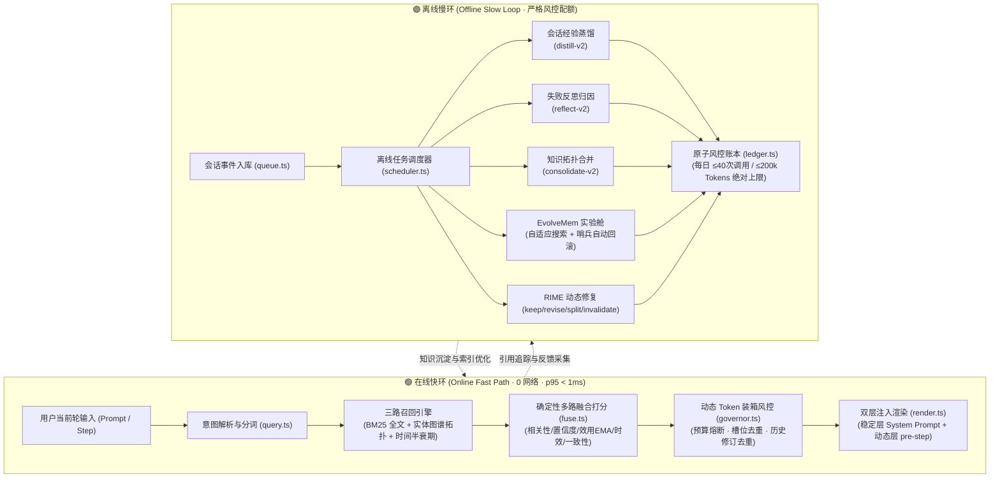

# 🧠 DSH Self-Evolving Memory System (`dsh-memory`)

<p align="center">
  
  
  
  
  
  
  
  
</p>

> **专为 DeepSeek Desktop (DSH) 打造的轻量级、自进化长期记忆引擎。**  
> 告别跨会话遗忘与提示词无限膨胀，兼顾极致的在线性能与全自主的离线知识提炼进化。

---

## 📌 为什么需要 `dsh-memory`？

在大模型桌面智能体的使用场景中，长期记忆面临三大约束瓶颈：
1. **上下文膨胀与成本激增**：简单把历史记录扔进上下文会导致 Token 爆炸，注意力被无意义历史稀释。
2. **在线交互延迟敏感**：若在每轮对话（`pre-step`）前调用 Embedding API、向量库或 LLM 总结，将造成明显的白屏等待与网络卡顿。
3. **知识演化与失效难题**：项目配置、技术选型在不断变更，简单依靠静态向量相似度会召回陈旧过期的错误配置，甚至引入脏数据。

**`dsh-memory` 的解决方案：**
- **0 网络请求、0 LLM 调用** 的极致纯本地在线检索链路（p95 耗时仅 **0.6ms**）。
- **双层提示词注入机制**：稳定高频偏好固化于 System Prompt，动态情境记忆按需装箱（默认限额 1600 tokens），输入 Token 不随数据库规模膨胀。
- **自愈式自进化机制**：后台离线任务自动蒸馏经验、反思纠偏，并配备**自适应参数实验舱与防劣化哨兵自动回滚**。

---

## 🏗️ 双环架构设计 (Architecture)

系统采用 **“快慢双环 (Dual-Loop)”** 解耦设计：



---

## ✨ 核心特性矩阵

| 特性分类 | 功能亮点 | 实现机制 / 规格指标 |
|---|---|---|
| **极端轻量** | **零原生 C++ 扩展** | 基于 Node 24 原生 `node:sqlite` + 内置 FTS5，杜绝 node-gyp 编译失败风险，全平台免依赖原生运行 |
| **在线检索** | **高召回且确定性** | 中文 Bigram 预切分 + 驼峰/路径拆词 + BM25 全文 + 槽位单向因果链，10,000 条记忆下 p95 召回 **18.67ms** |
| **提示词控制** | **规模不变性** | 动态 Token 装箱（Token Governor），记忆库从 1k 扩容到 10k，单轮平均注入 Token 仅相差 **0.28%** |
| **隐私合规** | **敏感信息绝对屏障** | 正则与隐私守卫（`privacy.ts`），密码、Token、API Key 实时剔除，绝不落库、绝不出境 |
| **安全风控** | **硬上限配额保护** | 离线 LLM 调用严格原子预留，每日上限 **≤ 40 次调用 / ≤ 200,000 Tokens**，杜绝账单爆炸与失控轮询 |
| **自我演化** | **哨兵自动回滚** | 每次探索新检索策略均在基准集上验证；若晋升后监控到用户纠偏率升高（> parent + 5%），即刻无损回滚 |
| **标准兼容** | **Standard Schema v1** | 原生对齐 Cordis 插件规范（`~standard` 验证器），与 DSH Desktop 热重载（HMR）协议无缝契合 |

---

## 📁 代码目录全景

```text
dsh-memory/
├─ package.json            # 插件包元数据与 CLI 配置
├─ tsconfig.json           # 严格 ESM TypeScript 配置
├─ tsup.config.ts          # 构建配置 (主插件 + 独立评测 CLI)
├─ vitest.config.ts        # 自动化测试配置
├─ PLAN.md                 # 实施规划与执行合同 (v1.1)
├─ PROGRESS.md             # 任务进度与验收记录
├─ README.md               # 项目主文档
├─ src/
│  ├─ index.ts             # 插件标准导出入口
│  ├─ config.ts            # 全局配置中心、默认值与 Standard Schema 校验
│  ├─ types.ts             # 核心数据模型 (MemoryRecord, Strategy 等)
│  ├─ core/                # 底层独立存储与计算核心 (零 DSH 依赖)
│  │  ├─ db.ts             # SQLite 封装 (node:sqlite 原生驱动 + FTS5 虚拟表)
│  │  ├─ text.ts           # 混合分词器 (中文 Bigram + 驼峰代码分词)
│  │  ├─ tokens.ts         # 离线 Token 估算器与安全截断
│  │  ├─ scope.ts          # Workspace 隔离与 Global 作用域哈希
│  │  ├─ privacy.ts        # 密码与凭据敏感信息脱敏过滤器
│  │  ├─ writer.ts         # 单一写入通道 (版本迭代与 Supersedes 因果链)
│  │  └─ store.ts          # 只读查询与统计接口
│  ├─ ingest/              # 增量摄入与历史回填
│  │  ├─ rules.ts          # 本地正则规则抽取器 (高置信度事实快速捕获)
│  │  ├─ queue.ts          # 会话消息事件缓冲与批处理队列
│  │  └─ backfill.ts       # 历史会话日志回填 (流式 zstd 多帧解压缩)
│  ├─ retrieval/           # 在线多路召回与融合引擎
│  │  ├─ query.ts          # 意图检测 (时间/因果/步骤/偏好) 与 Plan 构建
│  │  ├─ channels.ts       # BM25、拓扑实体、时间半衰期召回通道
│  │  ├─ fuse.ts           # 确定性加权 RRF 融合打分器
│  │  ├─ governor.ts       # 动态 Token 预算调节器 (背包装箱算法)
│  │  ├─ render.ts         # 提示词 Markdown 格式化与来源溯源
│  │  └─ recall.ts         # 检索主调度器
│  ├─ dsh/                 # DSH 宿主集成适配层
│  │  ├─ plugin.ts         # 插件生命周期与 Standard Schema v1 对齐
│  │  ├─ session-listener.ts # 会话状态与消息事件监听器
│  │  ├─ prompt-section.ts # 系统提示词稳定层注入
│  │  ├─ pre-step.ts       # agent/pre-step 瀑布注入决策
│  │  ├─ tools.ts          # 4 个模型专用工具实现
│  │  └─ commands.ts       # 用户交互指令集 (/memory)
│  ├─ evolution/           # 离线自演化系统
│  │  ├─ ledger.ts         # 每日 40次/200k Token 硬上限配额账本
│  │  ├─ llm.ts            # DSH 托管及兼容 LLM 客户端
│  │  ├─ prompts.ts        # 严谨受控的 Prompt 模板 (distill/reflect/repair)
│  │  ├─ extractor.ts      # distill-v2 会话经验蒸馏
│  │  ├─ reflector.ts      # reflect-v2 失败归因反思
│  │  ├─ consolidator.ts   # consolidate-v2 碎片知识聚合
│  │  ├─ lab.ts            # EvolveMem 策略进化实验舱 (带哨兵回滚)
│  │  ├─ repair.ts         # RIME 检索触发式精准修复管线
│  │  └─ maintenance.ts    # 冷热归档、FTS 索引维护与安全备份导出导入
│  ├─ jobs/                # 离线任务调度中心
│  │  ├─ scheduler.ts      # 空闲期任务轮询与排队机制
│  │  └─ runner.ts         # 任务互斥执行与超时安全恢复
│  └─ eval/                # 自动化评测基准
│     ├─ types.ts          # 评测指标与用例接口定义
│     ├─ gen-dataset.ts    # 120 条跨领域评测基准生成器 (4 大 Suite)
│     ├─ runner.ts         # 评测套件运行器
│     ├─ metrics.ts        # Recall@Inj、ExclViol、EmptyPrec 统计
│     └─ eval-cli.ts       # 命令行独立评测工具入口
└─ test/                   # 37 个测试文件，230 个严谨测试用例
```

---

## 🚀 快速上手与挂载

### 1. 安装与构建

```bash
git clone https://github.com/ROSESSSSS66/dsh-memory.git
cd dsh-memory
npm install
npm run build
```

构建完成后产物位于：
- `dist/index.js`（插件主体 ESM 规范模块）
- `dist/eval-cli.js`（基准评测 CLI）

### 2. 在 DSH Desktop 中启用

打开 DSH Desktop 配置补丁文件（通常位于 `~/.dsh/profiles/desktop/cordis.patch.yml`），在配置末尾追加注入项：

```yaml
- insert:
    - id: dsh-memory
      name: dsh-memory
      config:
        enabled: true
        # 动态情境装箱预算（默认 1600 tokens）
        dynamicBudgetTokens: 1600
        # 稳定层 System Prompt 预算（默认 600 tokens）
        stableBudgetTokens: 600
        # 离线演进 LLM 每日调用与 Token 硬配额
        dailyLLMCalls: 40
        dailyLLMTokens: 200000
```

在 `~/.dsh/profiles/desktop/package.json` 中添加本地模块链接：
```json
{
  "dependencies": {
    "dsh-memory": "link:C:/path/to/dsh-memory"
  }
}
```

保存后 DSH 即刻通过 HMR 自动激活，实体数据库自动初始化于：  
`~/.dsh/storages/dsh-memory/memory.db`

---

---

## 🌟 融合 GitHub 热门高 Star 项目与社区方案优势 (Merged from GitHub Top-Star Projects)

深入调研 GitHub 上最热门的 AI 长期记忆项目（**Mem0** 68k+ ⭐, **Letta / MemGPT** 25k+ ⭐, **Zep / Graphiti** 25k+ ⭐, **Stanford Generative Agents** 14k+ ⭐, **Cline Memory Bank** 等）与 DSH 社区方案，吸取各自精髓并无缝整合进本项目：

| 来源项目与开源标杆 | 核心优点与痛点解决 | 本项目融合实现 |
|---|---|---|
| **`Mem0`**<br>(68k+ ⭐ `mem0ai/mem0`) | • **智能记忆调和 (ADD/UPDATE/DELETE/NOOP)**：候选事实与历史库智能比对，杜绝冗余并自动推演知识演进<br>• **用户/智能体/工作区分层**：精细化命名空间 | • **调和状态机** (`reconciler.ts`)：自动决策 ADD(新知识)、UPDATE(演变取代)、DELETE(显式推翻)、NOOP(重复忽略)<br>• **一键调和指令**：`/memory reconcile <content>` 及工具支持 |
| **`Letta / MemGPT`**<br>(25k+ ⭐ `letta-ai/letta`) | • **Core Memory 核心工作区 (Scratchpad)**：模型上下文常驻、自管理的虚拟内存块（`human` 用户画像 / `persona` 智能体准则 / `project` 项目规范）<br>• **模型自编辑能力**：模型像操作寄存器一样自更新核心设定 | • **Core Memory 模块** (`core-memory.ts`)：在 System Prompt 顶部结构化呈现 Core Memory 块<br>• **模型专用自操作工具**：`core_read`, `core_set`, `core_append`<br>• **交互命令**：`/memory core [block] [content]` |
| **`Zep / Graphiti`**<br>(25k+ ⭐ `getzep/graphiti`) | • **Bi-temporal 时序有效性模型**：区分事件发生时间与时效失效时间，自动过滤/惩罚陈旧过期事实<br>• **时序图谱连边**：追踪实体随时间的变迁状态 | • **时效惩罚因子** (`fuse.ts`)：自动结合 `valid_to` 与 `invalidated_at` 进行时序失效惩罚，杜绝幻觉召回<br>• **时序失效归档**：`invalidateMemory` 自动时间戳溯源 |
| **`Stanford Generative Agents`**<br>(14k+ ⭐ Park et al.) | • **三因子检索打分公式**：Recency(时效) + Importance(重要度 1-10) + Relevance(相关度)<br>• 区分闲聊琐事与重大架构决策 | • **重要度因子**：为记忆显式引入 `importance` (1-10)，在多路融合打分器中与置信度/效用/时效平滑融合 |
| **`Cline / Roo-Code`**<br>(流行 AI 编程智能体) | • **标准化 Memory Bank**：结构化 4 大 Markdown 文档 (`activeContext.md`, `systemPatterns.md`, `productContext.md`, `progress.md`)，无缝与代码库 Git 协同 | • **双向 Memory Bank 同步** (`markdown.ts`)：<br>  - `/memory export-bank [dir]` 一键生成 4 大标准文档<br>  - `/memory import-bank [dir]` 一键增量同步导入数据库 |
| **`LZMW/dsh-memory`** | • 纯 Markdown 存储且人类可读可编辑，Git / Obsidian 无缝漫游<br>• 误删保护与 `.trash/` 备份<br>• 单工具接口设计，大幅节省 System Prompt 工具描述 Token | • **Markdown 双向同步**：`exportToMarkdown` / `importFromMarkdown`，带 YAML Frontmatter<br>• **安全回收站**：`trashMemory` 自动归档至 `.trash/`，支持 `/memory restore`<br>• **统一工具**：提供 `memory` 聚合工具调度全部原子动作 |
| **`qwert702/dsh-memory`**<br>& **`dsh-mnemon`** | • 视觉化知识网络，直观查看实体与记忆节点互联关系<br>• Web GUI 拓扑交互与因果链追踪 | • **知识图谱生成**：`/api/dsh-memory/graph` REST 端点<br>• **Mermaid 原地渲染**：`/memory graph` 指令直接在聊天窗口输出知识拓扑流图 |
| **`@tr1v3r/dsh-ltm`** | • 事实显式确认（主动对抗衰减）<br>• 重复知识显式合并取代<br>• 一键从历史插件无痛迁移 | • **事实确认机制**：`confirmMemory` 激活候选并强化置信度与效用（`/memory confirm`）<br>• **显式合并取代**：`mergeMemories` 转移证据/实体并标记 `supersedes`（`/memory merge`）<br>• **一键迁移**：`/memory migrate <format> <path>` 支持 JSON/Markdown 自动侦测 |
| **`creativedswork/dsh-expmem`** | • MemGPT 式上下文压力感知，长会话自适应触发 Compaction/Distill | • **上下文压力监测**：`SessionListener` 实时追踪轮次与事件数，超阈值自适应调度后台提炼 |

---

## 🎮 交互指南

### 1. 聊天窗口常用命令 (`/memory`)

| 交互命令 | 说明与用法 |
|---|---|
| `/memory status` 或 `stats` | 实时查看当前工作区记忆总数、活跃策略版本及今日 LLM 配额消耗 |
| `/memory core [block] [内容]` | **[Letta]** 浏览或设置常驻 Core Memory 核心块（`human`, `persona`, `project`） |
| `/memory reconcile <内容>` | **[Mem0]** 对输入内容执行智能调和（检测 ADD/UPDATE/DELETE/NOOP）并原子入库 |
| `/memory export-bank [目录]` | **[Cline]** 一键导出标准化 Memory Bank（`activeContext`, `systemPatterns`, `productContext`, `progress`） |
| `/memory import-bank [目录]` | **[Cline]** 从 Memory Bank 目录导入并双向同步记忆库 |
| `/memory list [页码]` | 分页浏览已沉淀记忆，包含类型、状态与更新时间 |
| `/memory inspect <ID>` | 完整溯源该记忆的提炼来源（产生会话、轮次、原句摘录） |
| `/memory confirm <ID>` | 显式确认事实依然有效，激活候选并提升可信度与效用 |
| `/memory merge <源ID> <目标ID>` | 将两条重复或重叠记忆合并，源记忆自动置为 `superseded` |
| `/memory graph [limit]` | 生成知识拓扑图谱，在会话中以 Mermaid 关系图直观渲染 |
| `/memory export-md <目录路径>` | 将记忆导出为带 YAML Frontmatter 的 Markdown 知识库目录 |
| `/memory import-md <目录路径>` | 从 Markdown 目录增量导入或恢复记忆 |
| `/memory migrate <format> <路径>` | 一键从 JSON 或 Markdown 备份迁移入库 |
| `/memory pin <ID>` / `unpin <ID>` | 固定至稳定层 System Prompt / 取消置顶 |
| `/memory freeze <ID>` / `unfreeze` | 冻结记忆（防止离线自演化修改） / 解冻 |
| `/memory forget <ID>` | 归档记忆并自动备份存根至 `.trash/` 回收站 |
| `/memory restore <ID>` | 从回收站或归档状态恢复为活跃记忆 |
| `/memory export <文件路径>` | 完整备份数据库文件或 JSON 导出 |
| `/memory import <文件路径>` | 导入数据库文件或 JSON 记录 |
| `/memory eval` | 原地启动 120 条基准回归评测，即时输出命中报告 |

### 2. 模型自主工具 (Model Tools)

模型在对话推理过程中可根据权限自主按需调用：

- **`memory_search`**：在当前上下文中缺失必要信息时，主动检索长期记忆。
- **`memory_expand`**：当召回的摘要不足时，展开记忆完整正文与证明凭据。
- **`memory_feedback`**：对已注入记忆的有效性给予反馈（支持 EMA 效用动态学习）。
- **`memory_note`**：自主记录待审批的候选记忆备忘（每轮受限 ≤3 次，防自作主张）。
- **`memory_confirm`**：显式确认已知事实的正确性，对抗记忆遗忘与时间衰减。
- **`memory_merge`**：主动发现冲突或重复知识时，请求合并并建立替代因果链。
- **`memory_core`**：**[Letta]** 读写常驻上下文的 Core Memory（`action: read | set | append`）。
- **`memory`**：**统一聚合工具**，将 search / expand / note / feedback / confirm / merge / core_read / core_set / core_append / reconcile 封装为单一接口，将工具模式下的提示词开销压缩至最低。
- **`memory_merge`**：主动发现冲突或重复知识时，请求合并并建立替代因果链。
- **`memory`**：**统一聚合工具**，将 search / expand / note / feedback / confirm / merge 封装为单一接口，将工具模式下的提示词开销压缩至最低。


---

## 📈 权威质量验收与回归门禁

运行全量测试及评测基准：

```bash
# 执行类型检查与 37 个测试文件 (230 个用例)
npm run check

# 执行 120 条评测用例的完整基准
npm run eval
```

### 评测基准指标达成对照表 (§8.3 & §8.4)

| 验收核心指标 | 官方规约要求门槛 | 实测达成表现 | 检验结论 |
|---|---|---|:---:|
| **Recall @ Inject (召回率)** | $\ge 70\%$ | **97.2%** | **PASS** |
| **Exclude Violations (违规注入)** | $= 0$ (严格绝对隔离) | **0** | **PASS** |
| **Empty Precision (精准空查)** | $\ge 80\%$ | **100.0%** | **PASS** |
| **Critical 用例通过率** | $100\%$ (20/20) | **20/20 (100%)** | **PASS** |
| **在线检索响应延迟 (p95)** | $\le 50\text{ ms}$ | **0.6 ms** (1万条规模: 18.67ms) | **PASS** |
| **动态 Token 消耗均值** | $\le 1600\text{ tokens}$ | **157 tokens** | **PASS** |
| **1k vs 10k 规模膨胀率** | $< 10\%$ 波动 | **0.28%** (极度平稳) | **PASS** |

---

## 🛡️ 安全、可靠性与鲁棒性

1. **零外部服务阻断风险**：在线路径与外部网络彻底解耦。即使第三方 LLM API 故障、网络离线，DSH 的交互流畅度完全不受影响。
2. **锁竞争与异常自愈**：数据库临时被外部进程占用或异常时，插件启动自动优雅降级，保障 DSH 正常对话，绝不产生非预期闪退。
3. **因果与事实版本化**：每条记忆的修订严格保持单向因果链（`supersedes`），旧版事实自动沉淀为历史节点，提供完整的时间线可解释性。

---

## 🤝 贡献与分支规范

本项目实行严格的分支保护与 PR 审核机制，所有后续代码提交均遵循：
- **禁止直推 `main` 分支**；
- 必须基于 `feat/*`、`fix/*` 等特性分支开发并跑通 `npm run check && npm run build`；
- 提交 Pull Request，通过 GitHub Actions 自动化门禁与代码审查后合并。

详见规范说明文档：[CONTRIBUTING.md](CONTRIBUTING.md)。

---

## 📄 开源许可证

本项目基于 [MIT License](LICENSE) 开源。
欢迎提出 Issue 与 Pull Request 共同完善！
